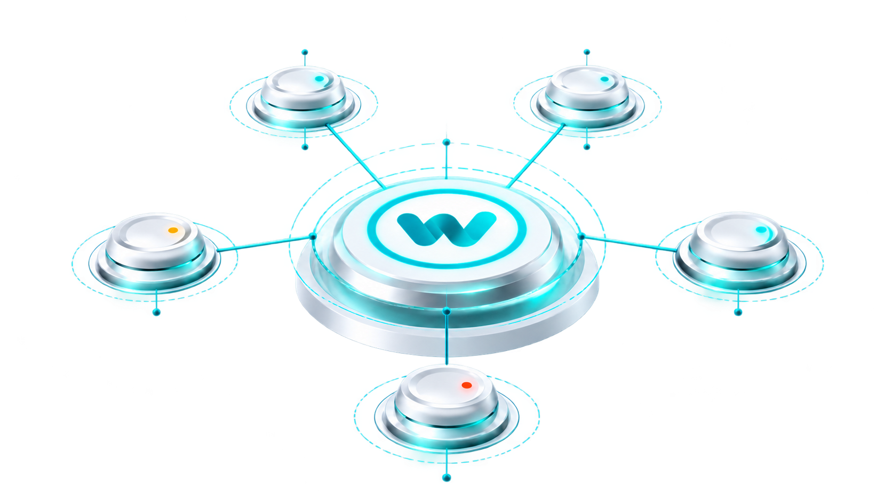
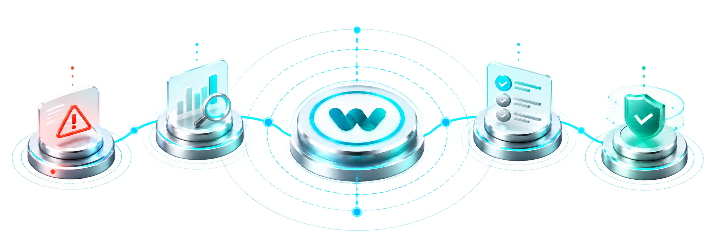

<div align="center">
  
  <h1>Waslix</h1>
  <h3>Know which customers need you.<br />Before they tell you.</h3>
  <p>Customer health. Clear priorities. Accountable action.<br />One workspace for the entire customer journey.</p>

  <p>
    
    
    
    
  </p>

  <p><strong>English & العربية &nbsp; · &nbsp; LTR & RTL &nbsp; · &nbsp; Light & Dark</strong></p>
  <p>
    <a href="#the-product">Explore the product</a> &nbsp; / &nbsp;
    <a href="#quick-start">Run locally</a> &nbsp; / &nbsp;
    <a href="#under-the-hood">Under the hood</a>
  </p>
  <br />
  <picture>
    <source media="(prefers-color-scheme: dark)" srcset="public/images/hero-section-image-dark.png" />
    
  </picture>
  <br />
  <sub>Customer evidence, connected.</sub>
</div>

<br />

## The product

Customer Success teams shouldn't have to piece together an account story from scattered records. **Waslix connects the evidence to the work:** understand customer health, spot what needs attention, and give the next action an owner.

<table>
  <tr>
    <td width="33%" valign="top">
      <h3>01 / Understand</h3>
      <p>One customer view for contacts, goals, activity, tasks, and lifecycle context.</p>
      <strong>The full account story.</strong>
    </td>
    <td width="33%" valign="top">
      <h3>02 / Prioritize</h3>
      <p>Explainable health, grouped signals, and evidence-backed attention.</p>
      <strong>Know why it matters.</strong>
    </td>
    <td width="33%" valign="top">
      <h3>03 / Act</h3>
      <p>Owned tasks, next-action recommendations, and repeatable playbooks.</p>
      <strong>Move the account forward.</strong>
    </td>
  </tr>
</table>

### From the first milestone to the next renewal

|     | Capability                | What it brings to your team                                        |
| :-: | ------------------------- | ------------------------------------------------------------------ |
|  ◉  | **Customer 360**          | Contacts, lifecycle, goals, and a shared account timeline          |
|  ◈  | **Explainable health**    | Weighted evidence, freshness, confidence, and historical snapshots |
|  ◎  | **Signals & attention**   | Grouped priorities with the evidence behind each one               |
|  ↗  | **Onboarding & renewals** | Milestones, readiness, renewal windows, and explicit outcomes      |
|  ✓  | **Tasks & playbooks**     | Recommendations that become owned, trackable work                  |
|  ⌕  | **Portfolio operations**  | Analytics, workspace search, and CSV customer import               |

<br />

<div align="center">
  <picture>
    <source media="(prefers-color-scheme: dark)" srcset="public/images/connect-section-image-dark.png" />
    
  </picture>
  <p><strong>One connected workflow. Shared context at every step.</strong></p>
</div>

### Built for the way your team works

- **Two languages, equal footing.** English and Arabic routes, localized catalogs, and RTL layouts.
- **Clear ownership.** Admin, CS Manager, CSM, and Viewer roles within isolated workspaces.
- **Health you can explain.** Deterministic scoring preserves missing evidence instead of treating it as zero.
- **A history that stays connected.** Activities and system events keep the account context with the work.

---

## Quick start

**You'll need:** Node.js **22.13+** on the Node 22 LTS line, npm, and Docker Compose.

### 1. Get the project

```bash
git clone https://github.com/AshrafMurad/waslix.git
cd waslix
npm install
cp .env.example .env
```

<details>
<summary><strong>Using Windows PowerShell?</strong></summary>

Use `Copy-Item .env.example .env` for the environment-copy step.

</details>

### 2. Prepare your workspace

```bash
docker compose up -d
npm run db:migrate
npm run db:seed
```

The seed builds a deterministic demo portfolio. Sign in locally with `admin@example.com` and the `SEED_FIXTURE_PASSWORD` configured in `.env`.

### 3. Make it yours

```bash
npm run dev
```

**[Open in English →](http://localhost:3000/en)** &nbsp; **[افتح بالعربية ←](http://localhost:3000/ar)**

<details>
<summary><strong>Environment configuration</strong></summary>

Start from `.env.example`. Replace development placeholders before deploying.

| Variable                | Purpose                                                |
| ----------------------- | ------------------------------------------------------ |
| `DATABASE_URL`          | Application PostgreSQL connection                      |
| `BETTER_AUTH_URL`       | Canonical authentication origin                        |
| `BETTER_AUTH_SECRET`    | Random authentication secret of at least 32 characters |
| `NEXT_PUBLIC_APP_URL`   | Public browser origin                                  |
| `TEST_DATABASE_URL`     | Isolated database for integration and E2E tests        |
| `SEED_FIXTURE_PASSWORD` | Password for local seeded accounts                     |

</details>

---

## Under the hood

**Next.js 16 + React 19** power the application. **PostgreSQL + Prisma** hold the operational records. Domain modules keep customer workflows, authorization, and background processing organized around the work they own.

| Layer           | Stack                                                |
| --------------- | ---------------------------------------------------- |
| Interface       | Tailwind CSS 4 · Radix UI · Recharts                 |
| Identity        | Better Auth · Workspace-scoped role permissions      |
| Localization    | next-intl · English / Arabic catalogs                |
| Background work | pg-boss · Dedicated worker entry points              |
| Quality         | TypeScript · ESLint · Prettier · Vitest · Playwright |
| Delivery        | Docker · Separate web and worker services            |

<details>
<summary><strong>Explore the codebase</strong></summary>

```text
waslix/
├── src/
│   ├── app/[locale]/   Localized public and workspace routes
│   ├── components/     UI, layout, and marketing components
│   ├── modules/        Domain services, queries, and actions
│   ├── lib/            Auth, database, jobs, and permissions
│   └── worker/         Background job entry points
├── messages/           English and Arabic catalogs
├── prisma/             Schema, migrations, and demo seeds
└── tests/              Integration and browser suites
```

</details>

<details>
<summary><strong>Development & verification commands</strong></summary>

| Command                    | Purpose                                                |
| -------------------------- | ------------------------------------------------------ |
| `npm run dev`              | Start the development server                           |
| `npm run build`            | Create a production build                              |
| `npm run db:migrate`       | Apply committed migrations                             |
| `npm run db:seed`          | Rebuild deterministic demo data                        |
| `npm run worker:start`     | Start the background health worker                     |
| `npm run check`            | Check formatting, linting, types, i18n, and unit tests |
| `npm run test:integration` | Run PostgreSQL integration tests                       |
| `npm run test:e2e`         | Run Playwright browser tests                           |

Integration and browser tests require `TEST_DATABASE_URL`. Before running E2E tests, install Chromium with `npx playwright install chromium`.

</details>

<details>
<summary><strong>Workspace isolation & access</strong></summary>

Protected operations require an authenticated user, an active workspace membership, the appropriate role capability, and access to the requested object. Queries, jobs, search, imports, analytics, and history are scoped to the active workspace.

</details>

<details>
<summary><strong>Production deployment</strong></summary>

`Dockerfile` and `docker-compose.production.yml` define the web, worker, and PostgreSQL services. Configure production secrets outside source control, apply migrations before serving traffic, and verify the deployment with `npm run smoke:deployment`.

</details>

<br />

<div align="center">
  <hr />
  <br />
  
  <p><strong>Less scattered context. More meaningful action.</strong></p>
  <sub>Waslix · Customer success, connected.</sub>
  <br /><br />
  <a href="#waslix">Back to top ↑</a>
</div>
